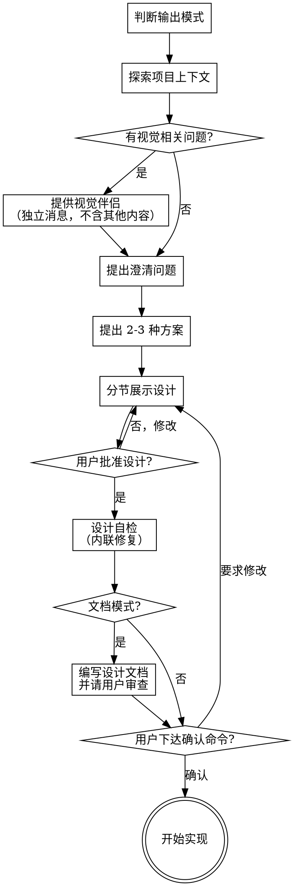

# 头脑风暴：将想法转化为设计

通过自然的协作对话，帮助将想法转化为完整的设计和规格说明。

首先了解当前项目的上下文，然后逐一提问来完善想法。一旦你理解了要构建的内容，就展示设计方案并获得用户批准。

<HARD-GATE>
在你展示设计方案并获得用户批准之前，不要调用任何实现技能、编写任何代码、搭建任何项目或采取任何实现行动。这适用于所有项目，无论看起来多简单。
</HARD-GATE>

## 输出模式

根据用户的表述决定设计的输出方式：

| 用户表述 | 模式 | 行为 |
|---------|------|------|
| 未明确要求生成文档（如"给出文本\*\*方案"） | 文本模式（默认） | 方案只在对话中展示，不创建任何文件 |
| 明确要求"生成\*\*文档/方案" | 文档模式 | 设计在对话中确认后写入设计文档，请用户审查 |

两种模式下，用户下达确认命令（如"确认无误，开始实施"）后都直接开始实现：有文档则参照文档，无文档则参照对话中确认的方案。不单独产出实现计划文档。

**文档分类与命名（仅文档模式）：**

文档分为四类：**实施方案、解决方案、可行性方案、需求文档**。根据用户要求的分类命名：

- 存放目录：`.doc/<yyyy-MM-dd>/`
- 命名规则：`.doc/<yyyy-MM-dd>/<topic>-<文档分类>.md`
- 示例：`.doc/2026-10-24/user-auth-实施方案.md`、`.doc/2026-09-06/payment-gateway-可行性方案.md`

## 反模式："这个太简单了，不需要设计"

每个项目都要经过这个流程。一个待办事项列表、一个单函数工具、一个配置变更——全都需要。"简单"的项目恰恰是未经检验的假设造成最多浪费的地方。设计可以很简短（对于真正简单的项目几句话就够了），但你必须展示出来并获得批准。

## 检查清单

你必须为以下每个条目创建任务，并按顺序完成：

1. **判断输出模式** — 见上方"输出模式"，确定用户是否明确要求生成文档
2. **探索项目上下文** — 检查文件、文档、最近的 commit
3. **提供视觉伴侣**（如果主题涉及视觉问题）— 这是一条独立的消息，不要与澄清问题合并。参见下方的"视觉伴侣"部分。
4. **提出澄清问题** — 每次一个，了解目的/约束/成功标准
5. **提出 2-3 种方案** — 附带权衡分析和你的推荐
6. **展示设计** — 按复杂度分节展示，每节展示后获得用户批准
7. **设计自检** — 快速内联检查占位符、矛盾、模糊性、范围（详见下方）
8. **写入设计文档**（仅文档模式）— 保存到 `.doc/<topic>-<文档分类>.md` 并请用户审查
9. **等待用户确认命令** — 用户确认无误并下达开始命令
10. **开始实现** — 参照文档（如有）或对话中确认的方案直接写代码

## 流程图

**终止状态是开始实现。** 用户下达确认命令后，直接参照文档（如有）或对话中确认的方案开始写代码。不再单独制定实现计划文档；任务较复杂时可用 TodoList 拆解步骤并跟踪进度。

## 流程详述

**理解想法：**

- 首先查看当前项目状态（文件、文档、最近的 commit）
- 在提出详细问题之前，先评估范围：如果需求描述了多个独立子系统（例如"构建一个包含聊天、文件存储、计费和分析的平台"），立即指出这一点。不要花时间用问题去细化一个需要先拆分的项目。
- 如果项目规模过大，单个设计无法覆盖，帮助用户分解为子项目：有哪些独立的部分，它们之间有什么关系，应该按什么顺序构建？然后通过正常的设计流程进行第一个子项目的头脑风暴。每个子项目都有自己的设计 → 确认 → 实现周期。
- 对于范围适当的项目，每次提一个问题来完善想法
- 尽量使用选择题，开放式问题也可以
- 每条消息只提一个问题——如果一个主题需要更多探索，拆分成多个问题
- 重点理解：目的、约束、成功标准

**探索方案：**

- 提出 2-3 种不同的方案及其权衡
- 以对话的方式展示选项，附上你的推荐和理由
- 先展示你推荐的方案并解释原因

**展示设计：**

- 一旦你认为理解了要构建的内容，就展示设计
- 每个部分的篇幅与其复杂度匹配：简单的几句话，复杂的最多 200-300 字
- 每个部分展示后询问是否正确
- 涵盖：架构、组件、数据流、错误处理、测试
- 随时准备回头澄清不明确的地方

**面向隔离和清晰的设计：**

- 将系统拆分为更小的单元，每个单元有一个明确的职责，通过定义良好的接口通信，可以独立理解和测试
- 对于每个单元，你应该能回答：它做什么，如何使用，它依赖什么？
- 别人能否不看内部实现就理解一个单元的功能？你能否在不影响调用者的情况下修改内部实现？如果不能，边界需要调整。
- 更小、边界清晰的单元也更便于你工作——你对能一次放入上下文的代码推理得更好，文件越专注你的编辑越可靠。当文件变大时，这通常意味着它承担了过多职责。

**在现有代码库中工作：**

- 在提出更改之前先探索现有结构。遵循现有模式。
- 如果现有代码存在影响当前工作的问题（例如文件过大、边界不清、职责纠缠），在设计中包含有针对性的改进——就像一个优秀的开发者在工作中改进经手的代码一样。
- 不要提议无关的重构。专注于服务当前目标的事情。

## 设计之后

**设计自检：**
设计获得用户批准后，以全新的视角审视它：

1. **占位符扫描：** 有没有"待定"、"TODO"、未完成的章节或模糊的需求？修复它们。
2. **内部一致性：** 各章节之间有矛盾吗？架构和功能描述匹配吗？
3. **范围检查：** 这是否聚焦到可以一次实现覆盖，还是需要进一步拆分？
4. **模糊性检查：** 有没有需求可以被两种方式理解？如果有，选择一种并明确写出来。

发现问题就直接内联修复。无需重新审查——修好继续推进。

**文档落盘（仅文档模式）：**

- 仅当用户明确要求"生成文档/方案"时，将验证通过的设计写入 `.doc/<yyyy-MM-dd>/<topic>-<文档分类>.md`
  - 文档分类：实施方案、解决方案、可行性方案、需求文档，按用户要求的分类命名
  - 示例：`.doc/2026-10-14/user-auth-实施方案.md`
  - （用户对文档位置的偏好优先于此默认值）
- 如果可用，使用 elements-of-style:writing-clearly-and-concisely 技能
- 写入后请用户审查文档内容
- 可选：按 `${KIMI_SKILL_DIR}/spec-document-reviewer-prompt.md` 调度规格文档审查员子代理
- 用户要求修改时，修改文档并重新运行设计自检
- 是否 commit 到 git 由用户决定，不要自动 commit

**确认与实现：**

- 等待用户下达确认命令（如"确认无误，开始实施"）
- 确认后直接开始实现：有文档则参照文档，无文档则参照对话中确认的方案
- 不单独制定实现计划文档；任务较复杂时可用 TodoList 拆解步骤并跟踪进度

## 核心原则

- **每次一个问题** — 不要同时抛出多个问题
- **优先选择题** — 在可能的情况下比开放式问题更容易回答
- **严格遵循 YAGNI** — 从所有设计中移除不必要的功能
- **探索替代方案** — 在做决定之前始终提出 2-3 种方案
- **增量验证** — 展示设计，获得批准后再继续
- **保持灵活** — 有不明确的地方就回头澄清
- **按需输出** — 默认只在对话中给出方案；用户明确要求时才生成文档；确认命令后直接开始实现

## 视觉伴侣

一个基于浏览器的伴侣工具，用于在头脑风暴过程中展示原型、图表和视觉选项。它是一个工具——不是一种模式。接受伴侣意味着它可用于适合视觉呈现的问题；并不意味着每个问题都要通过浏览器。

**提供伴侣：** 当你预计后续问题会涉及视觉内容（原型、布局、图表）时，提供一次以获得同意：
> "我们接下来讨论的一些内容，如果能在浏览器中展示给你看可能会更直观。我可以在讨论过程中为你制作原型、图表、对比图和其他视觉材料。这个功能还比较新，可能会消耗较多 token。要试试吗？（需要打开一个本地 URL）"

**此提议必须是一条独立的消息。** 不要将它与澄清问题、上下文摘要或任何其他内容合并。消息中应该只包含上述提议，没有其他内容。等待用户回复后再继续。如果他们拒绝，继续纯文本的头脑风暴。

**逐问题决策：** 即使用户接受了，也要对每个问题单独决定是使用浏览器还是终端。判断标准：**用户看到它是否比读到它更容易理解？**

- **使用浏览器** 展示本身就是视觉的内容——原型、线框图、布局对比、架构图、并排视觉设计
- **使用终端** 展示文本内容——需求问题、概念选择、权衡列表、A/B/C/D 文字选项、范围决策

关于 UI 主题的问题不一定是视觉问题。"在这个上下文中个性化是什么意思？"是一个概念问题——使用终端。"哪种向导布局更好？"是一个视觉问题——使用浏览器。

如果他们同意使用伴侣，在继续之前阅读详细指南：
`${KIMI_SKILL_DIR}/visual-companion.md`
